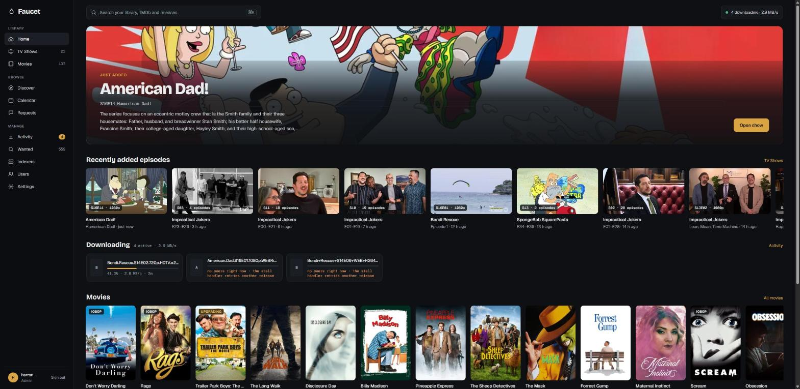
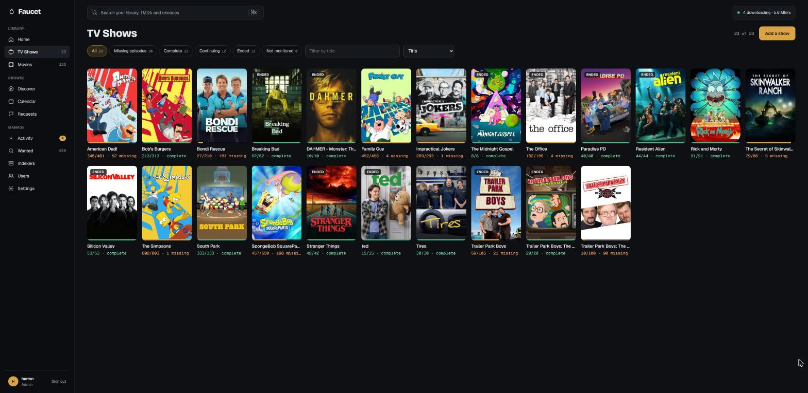
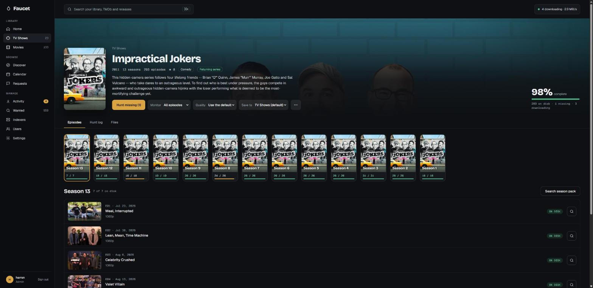
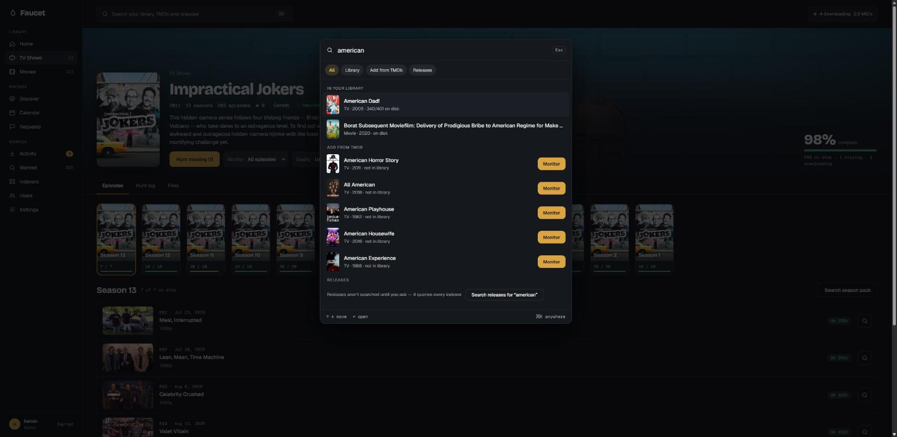
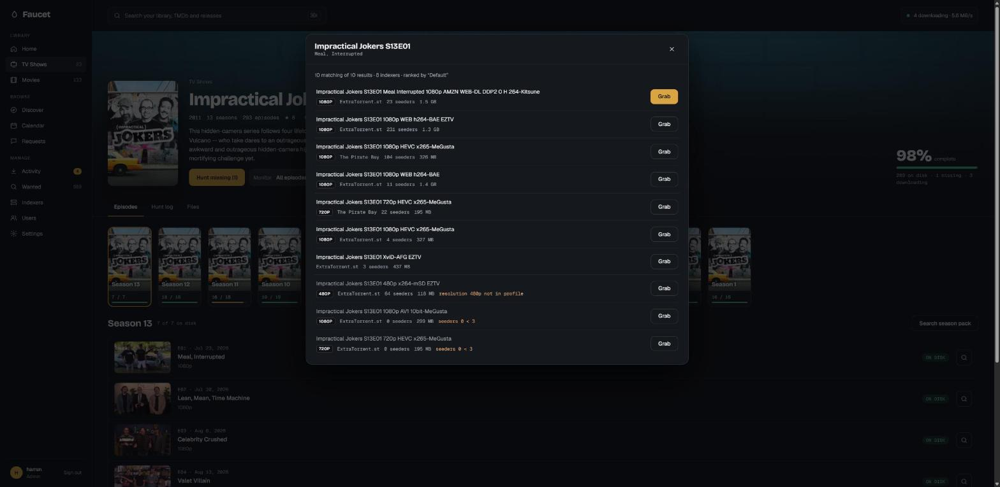
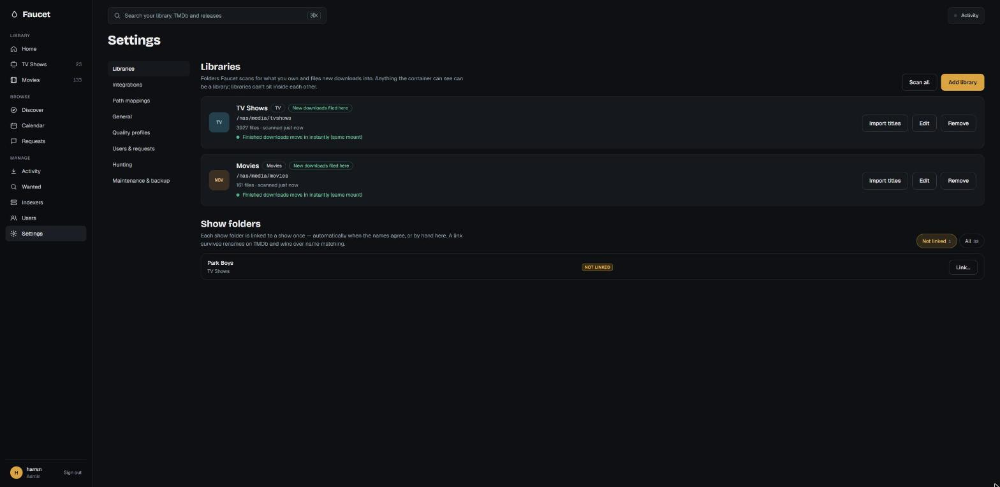
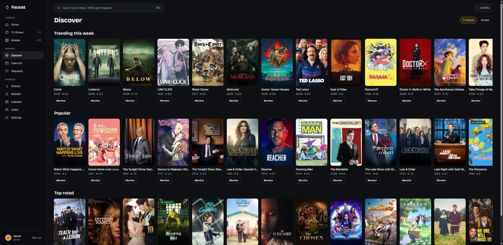
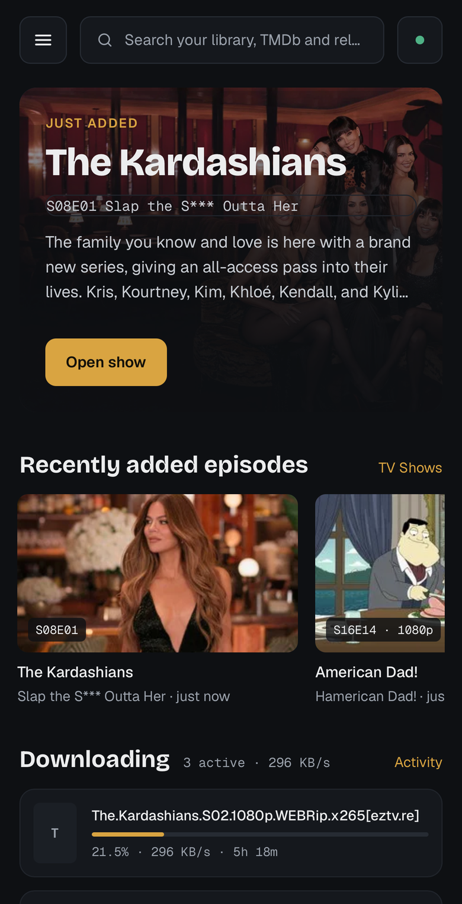

<div align="center">


# Faucet

**Your shows and movies — hunted, downloaded, sorted, requested and tracked, in one self-hosted app.**

Everything a Sonarr + Radarr + Overseerr stack does, as one container over your indexer and torrent client — with an interface that feels like Plex.

[](https://github.com/Harrsn/faucet/actions/workflows/ci.yml)
[](https://github.com/Harrsn/faucet/releases)
[](LICENSE)




</div>

---

Monitor a show and Faucet knows every episode that exists, sees which ones you already have, and hunts the rest — across every indexer at once, ranked by your quality rules, retried on a sensible schedule. Finished downloads are renamed and filed into a clean Plex / Jellyfin layout the moment they complete. The people you share your server with get their own accounts to browse and request; you approve.

It's one Python service with SQLite, no build step and a handful of dependencies. Point it at Jackett, a download client (Transmission, qBittorrent or Deluge) and a folder.

> **Heads up:** Faucet automates your own downloads. What you download, and staying within the law where you live, is on you.

## A look around

| | |
|---|---|
|  |  |
| **Libraries** — every library is its own section, Plex-style | **Show pages** — what's on disk, missing, downloading or unaired |
|  |  |
| **⌘K** — your library, TMDb and every indexer, from anywhere | **Release search** — ranked by your profile, rejects explained |
|  |  |
| **Settings** — libraries, integrations, hunting, users, all in the app | **Discover** — trending and popular, one click to monitor or request |

<p align="center"></p>

## What it does

**Tracks your library like Sonarr and Radarr.** Faucet reads every show's episode list from TMDb, matches it against what's on disk, and keeps a precise list of what's missing. Airing shows re-read their episode lists twice a day, ended shows weekly. Movies on disk below your quality target — or cam copies — are hunted for upgrades, and the old copy is parked, not deleted, when the better one lands.

**Searches properly.** Each indexer is queried on its own, in parallel, with structured queries (season and episode numbers, IMDb / TVDB ids) where it supports them. A slow Cloudflare-fronted indexer only delays its own results; one that's down only loses its own. Indexers that don't carry what you're looking for aren't asked. Releases are verified against the exact show and episode — spin-offs and wrong seasons don't get through — then ranked by your quality profile, seeders and each tracker's track record.

**Hunts patiently.** Wanted episodes are searched newest first, a capped number per run, backing off when nothing turns up (recent episodes are retried within hours, old backlog within days). Season packs are grabbed when most of a season is missing. Downloads that stall are dropped, blocklisted and replaced with another release. Every search is logged — open any show's hunt log to see what was found and why it was rejected.

**Files everything where it belongs.** A completion hook — plus a sweep for anything it misses — renames each download into `Show/Season 01/Show - S01E01.mkv` or `Movie (Year)/Movie (Year).mkv` and moves it into the right library, with an instant rename when downloads and media share a mount (Faucet checks this for you). Executable payloads and fakes are quarantined, not filed.

**Many libraries, like Plex.** Add as many libraries as you want — a separate collection for a relative, say — and each becomes its own section. Every show and movie has a library it's saved to, and Faucet routes its downloads there. Show folders are linked to shows once, automatically or by hand, so a renamed TMDb title or an odd folder name never makes a show look missing.

**Lets everyone else request.** Real accounts with roles: members browse your library, Discover and the calendar, and request titles; admins approve, decline, or auto-approve trusted people. The first account on a fresh install is the admin, and a setup wizard walks through the rest.

**Stays out of the way.** Settings live in the app, not in environment files. Pages never wait on a slow download client. A Prometheus `/metrics` endpoint, a health check, database backups and automatic housekeeping are built in.

## Quick start

```bash
git clone https://github.com/Harrsn/faucet.git && cd faucet
cp .env.example .env
python3 -c "import secrets; print('SESSION_SECRET=' + secrets.token_urlsafe(48))" >> .env
mkdir -p data/media/tvshows data/media/movies data/torrents
docker compose up -d
```

Open **http://localhost:8088** and create the admin account. The setup wizard then takes you through:

1. **Libraries** — `/data/media/tvshows` and `/data/media/movies` are ready; point them elsewhere or add more.
2. **Download client** — the bundled Transmission is pre-filled; test and save.
3. **Path mapping** — skip it with the bundled stack (both containers see `/data`).
4. **Indexer** — open Jackett at `http://localhost:9117`, add a few indexers, paste its API key.
5. **TMDb** — a free v3 API key from [themoviedb.org](https://www.themoviedb.org/settings/api), for posters, episode lists and matching.
6. **Import** — monitor everything already in your libraries.

One setting in Transmission itself: in its web UI (`http://localhost:9091`) → **Preferences → Torrents**, set the download folder to `/data/torrents` and the incomplete folder to `/data/torrents/incomplete`, so partial downloads live on the data volume too.

### Bring your own stack

Already running Jackett or a download client? Delete that service from `docker-compose.yml` and enter yours in the wizard. Two things to get right:

- **Paths.** If your client sees the download folder under a different path than Faucet does (Transmission on the host writes to `/mnt/nas/torrents`, Faucet's container sees `/data/torrents`), add a **path mapping** in Settings.
- **The completion hook.** Have your client run Faucet's hook when a download finishes. [docs/HOOKS.md](docs/HOOKS.md) covers Transmission, qBittorrent and Deluge, and [deploy/cascade-hook-wrapper.sh](deploy/cascade-hook-wrapper.sh) is a ready wrapper for a client on the host with Faucet in Docker. Without a hook, the sweep files finished downloads within a scheduler run.

### Storage layout

Put your libraries and your download folder **on one mount** — one volume in Docker, one share on a NAS:

```
/data
├── media
│   ├── tvshows
│   └── movies
└── torrents
```

Moving a finished download into a library is then a rename: instant, whatever the size. Mount `/downloads` and `/library` separately — even from the same disk — and every file is copied instead, through the network share if that's where it lives, while your download client stalls behind it. **Settings → Libraries** shows, for each library, whether downloads move in instantly or get copied.

## Configuration

Almost everything is in **Settings**: libraries and show-folder links, integrations (indexers with per-indexer health, download client, TMDb, notifications), path mappings, general defaults, quality profiles, users and requests, hunting, and maintenance. Changes apply on the next scheduler run — no restart, no redeploy.

The environment is only for bootstrap and infrastructure:

| Variable | Default | |
|---|---|---|
| `SESSION_SECRET` | generated | **Set it.** Signs session cookies; a fixed value keeps people signed in across restarts. |
| `EVENTS_FILE` | `/config/events.jsonl` | Where the database and event log live (the folder holding this file). |
| `TRUSTED_PROXIES` | — | Behind a reverse proxy: whose `X-Forwarded-*` / `CF-*` headers to believe. `auto` = the container's gateway. |
| `CLIENT_IP_HEADERS` | `cf-connecting-ip,x-real-ip,x-forwarded-for` | Which headers carry the client IP, in order. |
| `COOKIE_SECURE` | `auto` | Secure-cookie flag; `auto` follows HTTPS. |
| `SESSION_DAYS` · `LOGIN_*` · `REGISTER_IP_MAX` | 30 days · see [.env.example](.env.example) | Session lifetime and sign-in throttling. |
| `METRICS_TOKEN` | — | Bearer token for `/metrics`. |
| `MEDIASORT_MODE` | `auto` | How the sorter files a download: `auto` (hardlink, else move, else copy), `move`, `hardlink` or `copy`. |

Connection and behaviour settings found in the environment (`JACKETT_URL`, `CLIENT_PASS`, `HUNT_MAX_ACTIVE`, …) are **imported once** on the first start. After that Settings owns them and the environment is ignored, with a startup warning naming anything it skips.

## Security

- Every page and API call needs a session, and members can't reach admin endpoints. Sign-in is throttled per IP and username, with a per-account backstop.
- A strict Content-Security-Policy: scripts only from Faucet itself — no inline script, no eval, no third parties — and the interface escapes everything it renders.
- API keys, the client password and notification webhooks are write-only: the interface shows whether one is set, never the value, and error messages are scrubbed of them.
- Requests store metadata looked up server-side, never what the browser sent, and the folder picker only lists directories under the configured mounts.

## For developers

```bash
pip install --require-hashes -r requirements.txt -r requirements-dev.txt
pytest -q
ruff check faucet tests
for f in $(find faucet/static/app -name '*.js'); do node --check "$f"; done
```

Dependencies are pinned with hashes: edit the ranges in `requirements.in` / `requirements-dev.in` and regenerate the `.txt` files with the `uv pip compile` command at the top of each (CI fails if they drift). Dependabot proposes upgrades as pull requests.

FastAPI and SQLite on the back end; the interface is plain ES modules served as-is — no bundler, no framework, no `node_modules`. Download clients implement `faucet/clients/base.py`, and everything the interface does goes through the JSON API under `/api`. Issues and pull requests are welcome.

## License

MIT — see [LICENSE](LICENSE).
